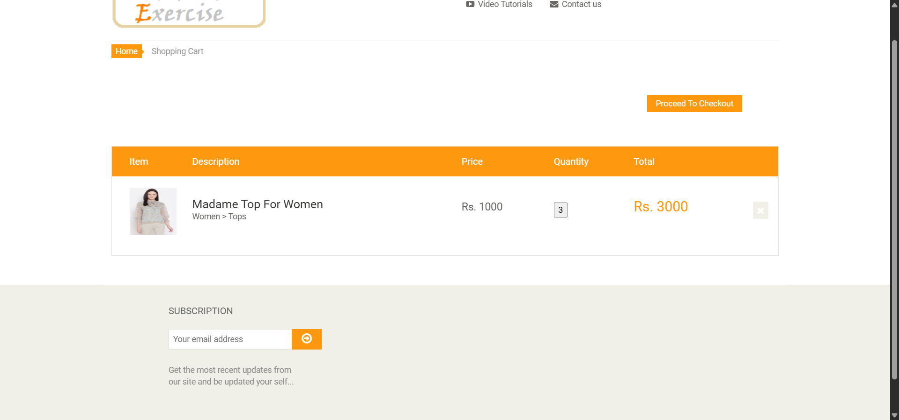

# Automation Exercise – Sepet Miktarı Doğrulama Testi

[Automation Exercise](https://automationexercise.com) e-ticaret sitesinde, ürün detay sayfasından girilen sipariş miktarının sepete doğru aktarıldığını doğrulayan **Python + Selenium** uçtan uca (end-to-end) testi.

> Yazılım Test ve Doğrulama dersi, Ödev – Grup 2 · Gökhan Rauf Yangel



## Test Senaryosu

| | |
|---|---|
| **Test kimliği** | TC-01 |
| **Ürün** | Madame Top For Women (Rs. 1000) |
| **Adımlar** | 1. Ana sayfada ürünün **View Product** butonuna tıkla<br>2. Sipariş miktarını **3** yap ve sepete ekle<br>3. Sepetteki miktarın sipariş miktarıyla eşleştiğini doğrula |
| **Beklenen sonuç** | Sepette 3 adet, toplam Rs. 3000 |
| **Sonuç** | ✅ Başarılı |

## Doğrulama Noktaları

Ödevde istenen ana kontrole ek olarak testin güvenilirliğini artırmak için altı kontrol daha yapılır:

| No | Kontrol | Sonuç |
|----|---------|-------|
| K1 | Doğru ürün sayfasının açılması | ✅ |
| K2 | Miktar kutusundaki değerin 3 olması | ✅ |
| K3 | Sepette tek ürün satırı bulunması | ✅ |
| **K4** | **Sepetteki miktarın 3 olması (ana kontrol)** | ✅ |
| K5 | Sepetteki ürün adının ürün sayfasıyla aynı olması | ✅ |
| K6 | Sepetteki birim fiyatın ürün sayfasıyla aynı olması | ✅ |
| K7 | Toplam fiyatın birim fiyat × miktar olması | ✅ |

### Negatif doğrulama

Testin gerçek bir uyuşmazlığı yakalayabildiğini göstermek için beklenen miktar bilerek `4` yapılarak test tekrar çalıştırılmıştır. Test beklendiği gibi yalnızca miktara bağlı iki kontrolde (K4 ve K7) başarısız olmuştur:

```
SONUÇ: TEST BAŞARISIZ (2 kontrol tutmadı)
  HATA: Sepetteki miktar (ANA KONTROL) eşleşmiyor. Beklenen 4, gerçekleşen 3
  HATA: Toplam fiyat (birim fiyat x miktar) eşleşmiyor. Beklenen 4000, gerçekleşen 3000
```

## Güvenilirlik Önlemleri

- **Reklam engelleme:** Tam ekran reklamların tıklamaları kapatmaması için reklam sunucuları Chrome DevTools Protokolü (CDP) ile engellenir.
- **Açık bekleme (explicit wait):** Her işlemden önce ilgili elemanın sayfada görünmesi beklenir.
- **Güvenli tıklama:** Eleman ekranın ortasına kaydırılır; önü kapalıysa JavaScript ile tıklanır.
- **Ürünün adına göre seçilmesi:** Ana sayfadaki ürün sırası değişse bile test doğru ürünle çalışır.

## Kurulum ve Çalıştırma

```bash
python -m venv venv
venv\Scripts\activate          # Windows
# source venv/bin/activate     # Linux / macOS

pip install -r requirements.txt
python urun_miktar_test.py
```

Sonuçlar ekrana ve `sonuc.txt` dosyasına yazılır, sepetin ekran görüntüsü `sepet.png` olarak kaydedilir. Test başarılıysa program `0`, başarısızsa `1` çıkış koduyla sonlanır.

## Proje Yapısı

```
├── urun_miktar_test.py   # Selenium test betiği
├── requirements.txt      # Python bağımlılıkları
├── docs/
│   └── sepet.png         # Test sonunda sepet sayfası
├── rapor/                # Test raporu (PDF)
└── README.md
```

## Kullanılan Teknolojiler

Python 3 · Selenium WebDriver 4 · Google Chrome / ChromeDriver

## Lisans

Bu proje [MIT Lisansı](LICENSE) ile lisanslanmıştır.
